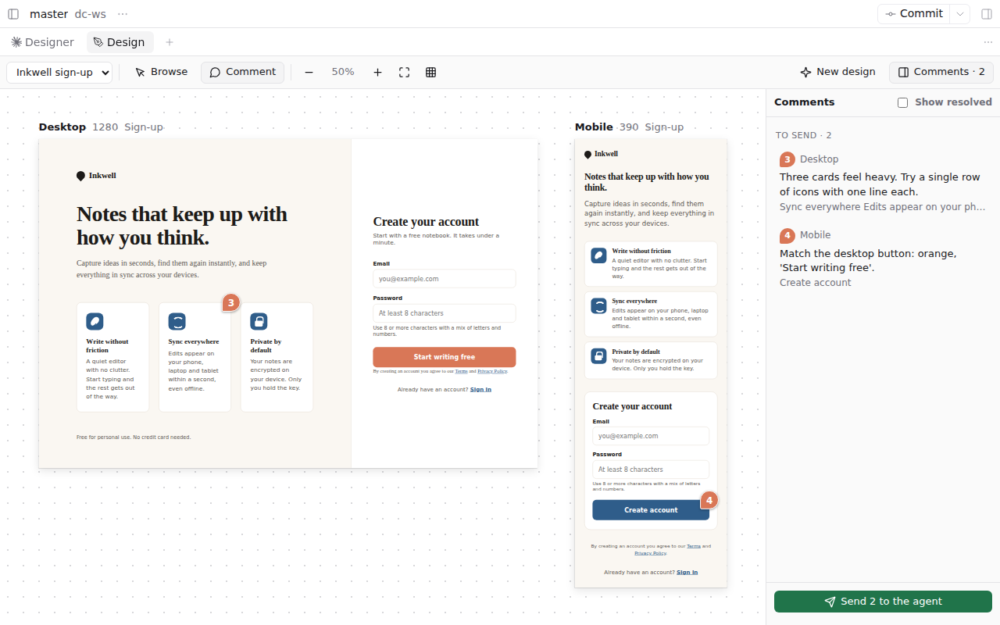
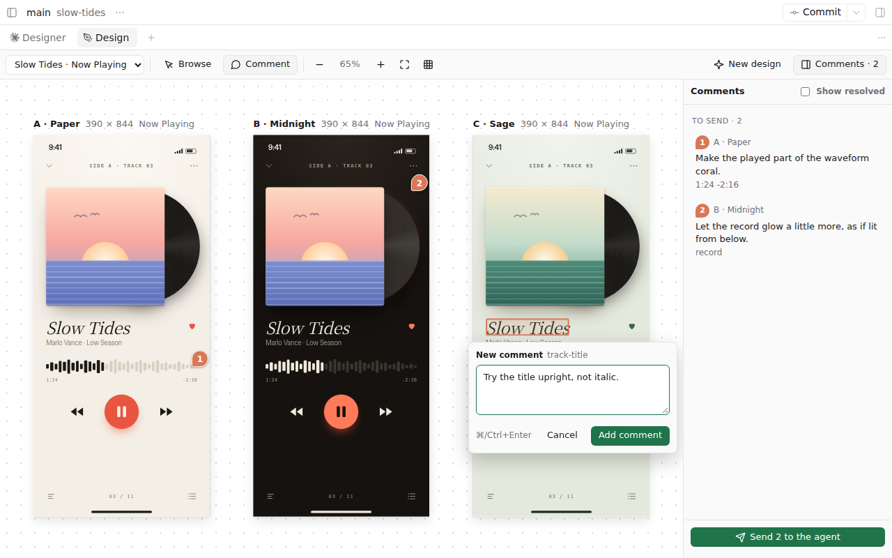
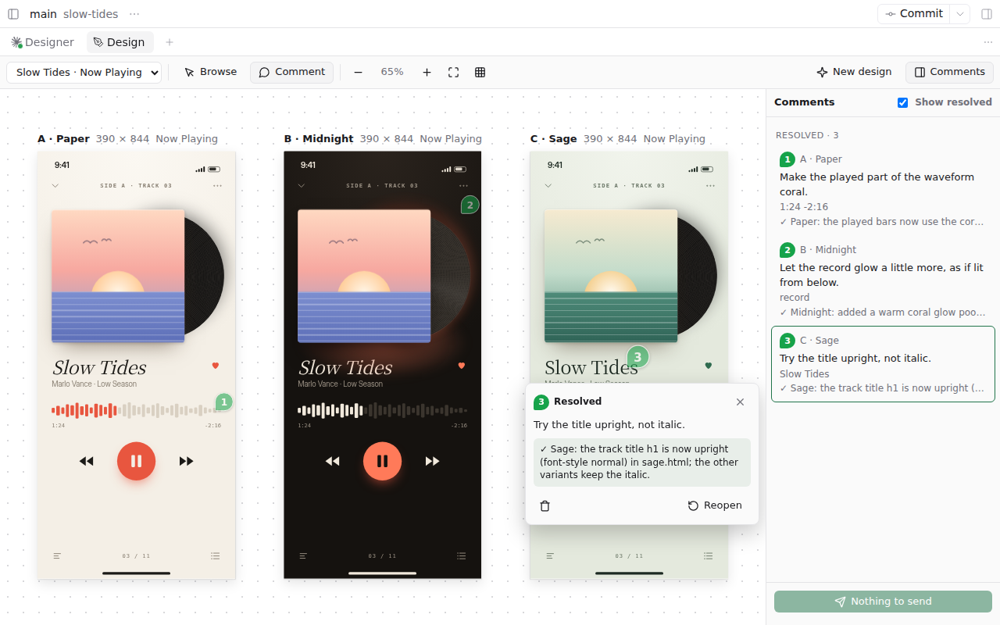

设计画布是人和 agent 一起做设计的地方。agent 用 HTML 画出设计画板；你并排查看，拖动元素、直接改字、微调数值，或者点中某个元素说要怎么改，agent 接着改。设计就是工作区里的文件，所以画设计的 agent 也能直接把它实现出来。

在命令中心选**打开设计画布**，或者在聊天里输入 `/canvas`，就能打开 agent 的**设计**标签页。还没有设计时，写下想要什么，点**交给 agent**；在聊天里输入 `/canvas <要设计什么>` 效果一样。agent 会用设计工具建好设计并逐个画出画板，画布会随着它写文件实时显示。

在画布上：

- 画板并排摆放，同一屏的不同方案放在一行。滚动来平移，Ctrl/Cmd+滚轮或按钮缩放，Ctrl/Cmd+0 适应窗口，Shift+G 显示 8 像素的布局网格。
- **移动**（V）会选中 agent 命名过的最近元素，拖动就能移动它；方向键每次微调 1 像素，按住 Shift 是 10 像素。拖画板的标题可以移动整个画板。双击文字（或选中元素后按 Enter）就能直接改字：Enter 保存，Esc 放弃。移动和改字会保存进设计的 HTML 和 `design.json`，Ctrl/Cmd+Z 撤销，Ctrl/Cmd+Shift+Z 重做。
- **手形**（H）下在任何地方拖动都是平移，在画板上也一样。用其他工具时按住空格也能临时切到手形。
- **预览**（P）下可以像用原型一样点来点去，指向其他画板页面的链接会跳到那个画板。
- **评论**（C）下会高亮鼠标下的元素。单击选中 agent 命名过的最近元素，Alt+单击选中精确的元素。写下要改什么，按 Ctrl/Cmd+Enter。
- 评论会以编号图钉的形式先攒着，点**发送给 agent** 时合成一条消息交给 agent，每条都注明对应的元素。agent 改完会把每条标为已解决，并写一句改了什么；已解决的图钉变成绿色，也可以重新打开。
- **微调**面板列出 agent 为这个设计声明的控件：颜色、滑块、开关和选项，每个控件对应一个 CSS 变量。拖动时所有画板同步变化，调好的值保存到 `tweaks.css`。**重置**恢复默认值，**写进设计**会请 agent 把当前的值写进设计的 CSS 和默认值，**让 agent 提议微调项**会请 agent 挑出值得调的参数并配置好。







## 要求

Paseo 0.14 或更高版本，daemon 和 app 都要。画布在桌面版和 Web 版里运行，手机 app 只显示一条提示。

agent 的设计工具（`design_create`、`design_list`、`design_read`、`design_resolve_comments`、`design_set_tweaks`）是通过 Paseo 自带的 agent 工具提供的，而 Paseo 0.15 默认关闭了这项功能。用下面的命令打开：

```bash
paseo daemon config set daemon.mcp.injectIntoAgents true
```

之后新建或重新打开的 agent，只要所在工作区有 `design/canvas.json`，就能拿到这些工具。第一次开始设计时，画布会创建这个文件，并重新打开 agent 的会话。没有工具时，agent 仍然可以按文件和 `design/README.md` 工作，并自己在 `comments.json` 里把评论标为已解决。

## 文件

所有内容都在工作区的 `design/` 目录下：

- `design/<名称>/design.json`：列出画板（id、标题、HTML 文件、宽度，以及可选的固定高度和方案分组）和微调项。
- `design/<名称>/<画板>.html`：每个画板一个独立的页面，使用本地的 CSS、图片和字体。
- `design/<名称>/comments.json`：评论；`tweaks.json` 和 `tweaks.css`：你调过的微调值。页面会引用 `tweaks.css`，所以在画布外打开也是同样的效果。
- `design/README.md` 写明给 agent 的约定，插件更新后会跟着更新；如果那里是你自己写的 README，插件不会动它。`design/canvas.json` 标记这个工作区在用画布。

## 读取和发送的内容

插件只读写 `design/` 下的文件。内联页面用到的本地 CSS、图片、字体和脚本时，指向 `design/` 外面的引用（包括符号链接）一律拒绝；如果某个设计文件夹本身是符号链接，插件会跟着它走。插件只在你开始一个设计、点**发送给 agent** 或点**让 agent 提议微调项**时给 agent 发消息，它没有自己的服务器。

每个画板都在沙箱框架里运行，访问不到 Paseo，并且有一条内容安全策略阻止页面从网络加载字体、图片、脚本和数据。但这条策略不能让设计完全断网，设计自己的代码仍有两种方式连到网络：

- 脚本可以把画板跳转到别的网址，并把任意内容放进网址里带出去。这条策略拦不住页面自己跳转。
- 写在页面 `<head>` 标签之前的代码会在策略生效前运行，因此可以从网络加载内容。

只打开你信任的设计，比如你自己的 agent 画的；别人给的设计，打开前先看看它的 HTML。

## 限制

- 只有带 `data-dc-id` 的元素能移动，因为移动是按这个 id 写回对应元素的。移动改的是元素的 `translate`（定位元素改 `left` 和 `top`），所以页面其他部分的排版不会变。调整大小还在计划中。
- 改字一次改一段文字，不能换行。SVG 里的文字和脚本生成的文字没法直接改；画布会提示，或者在页面源码里找不到这段文字时拒绝保存。
- 微调项通过页面根元素上的 CSS 变量生效，作用于设计里的所有画板。
- 来自 CDN 的字体、图片和脚本不会显示，因为那条策略会拦截它们。请把它们放进工作区。
- 重载或更新插件后，agent 要等下次会话打开时才会重新拿到设计工具。
- 评论先按 `data-dc-id` 找元素，再按页面里的位置找。agent 重写页面时去掉了 id 的话，图钉会退回到元素原来的位置。
