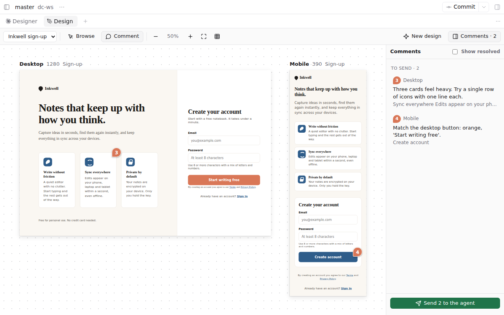
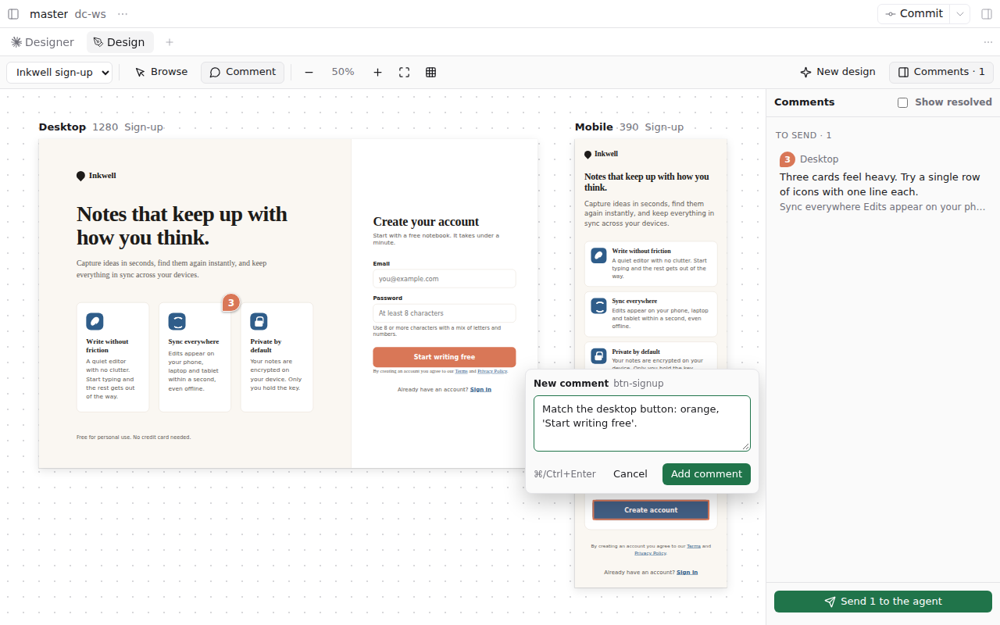

<!-- npm shows this file; the Paseo registry shows OVERVIEW.md. The sections after Install repeat
OVERVIEW.md, so change both together. -->

# Design canvas for Paseo

A [Paseo](https://paseo.sh) plugin that brings a Claude Design-style canvas to your agents.
Your agent draws designs as HTML artboards, you look at them side by side, point at an element and say what should change, and the agent revises. The designs are files in your workspace, so the agent that drew them can build them too.

Open the **Design** tab of an agent from the Command Center (**Open the design canvas**) or with `/canvas` in the chat. With no designs yet, describe what you want and press **Ask the agent**; `/canvas <what to design>` does the same from the chat. The agent sets the design up with its design tools and draws each artboard; the canvas shows it as it is written.

On the canvas:

- Artboards sit side by side, variants of one screen in one row. Scroll to pan, Ctrl/Cmd+scroll or the buttons to zoom, Ctrl/Cmd+0 to fit, Space+drag to pan over a design, Shift+G for an 8 px layout grid.
- **Browse** (V) lets you click through a prototype. Links to another artboard's page jump to it.
- **Comment** (C) highlights the element under the pointer. A click picks the nearest element the agent named, and Alt+click picks the exact one. Write what should change and press Ctrl/Cmd+Enter.
- Comments wait as numbered pins until you press **Send to the agent**, which hands them over in one message naming each element. The agent marks each one resolved with a line on what it changed; resolved pins turn green and you can reopen them.





## Install

From npm:

```bash
paseo plugin install npm:paseo-design-canvas
```

Or straight from the repository:

```bash
paseo plugin install git:961853266hyt/paseo-plugins:plugins/design-canvas
```

Update it later with `paseo plugin update design-canvas`. Plugins are trusted code: this one's server part runs on the daemon host and its client part inside the Paseo app.

## Requirements

Paseo 0.14 or later, daemon and app. The canvas runs in the desktop and web apps; the phone apps show a notice.

Agents get the design tools (`design_create`, `design_list`, `design_read`, `design_resolve_comments`) through Paseo's own agent tools, which Paseo 0.15 turns off by default. Turn them on with:

```bash
paseo daemon config set daemon.mcp.injectIntoAgents true
```

Agents created or reopened after that get the tools in any workspace that has `design/canvas.json`; the canvas creates it and reopens the agent's session the first time you start a design. Without the tools the agent still works from the files and `design/README.md`, and marks comments resolved in `comments.json` itself.

## Files

Everything lives under `design/` in the workspace:

- `design/<name>/design.json` lists the artboards: id, title, HTML file, width, optional fixed height and variant group.
- `design/<name>/<artboard>.html` is one self-contained page per artboard, with local CSS, images and fonts.
- `design/<name>/comments.json` holds the comments.
- `design/README.md` tells agents the conventions; `design/canvas.json` marks the workspace.

## What it reads and sends

The plugin reads and writes only files under `design/`, and refuses paths or links that lead outside it. Each artboard runs in a sandboxed frame with no access to Paseo and a policy that blocks every network request, so a design's scripts can run but reach nothing. Local assets are inlined before the page is shown. The plugin sends a message to the agent only when you start a design or press **Send to the agent**; it has no server of its own.

## Limits

- This first version has comments only. Editing text in place, dragging elements, and tweak sliders are planned.
- Designs cannot load anything from the network: fonts, images and scripts from a CDN do not appear. Put them in the workspace.
- After you reload or update the plugin, an agent gets its design tools back the next time its session opens.
- Comments point at elements by `data-dc-id`, then by position in the page. When the agent rebuilds a page without its ids, a pin falls back to where the element was.
